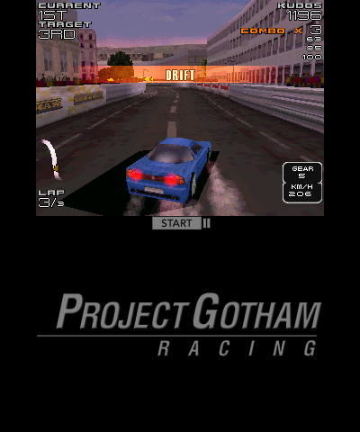

# Project Gotham Racing for New Nintendo 3DS



A native New 3DS adaptation of the Symbian version of Project Gotham Racing, built from the MGSM-derived compatibility implementation.

Requires a New Nintendo 3DS, New 3DS XL or New 2DS XL with a working homebrew setup.

## Installation

The complete installation archive already contains the prepared game files and soundtrack. Merge its `3ds/` folder into the SD-card root.

The extractor installation archive contains the application and soundtrack, plus `prepare_game.py`. Run it with the supported Symbian SIS/SISX package, then copy the resulting `3ds/` folder to the SD-card root. See the installation archive README for Windows, Linux and macOS commands.

Consider using the automated extractor for preparing your game files if that sounds complicated:
https://github.com/littleHatter/Airplay-New3DS-Game-Data-Preparation-Tool

The layout on the SD card is:

```
3ds/pgr_mobile/
    pgr_mobile.3dsx
    pgr_mobile.smdh
    game/
    music/
    user/              # created by the application for saves
```

Keep an existing `user/` folder when updating. Neither installation package includes or replaces save files.

## Prepare game data from source

The extractor uses Python 3.8+ and the standard library only; no additional packages or emulator are required:

```
python3 tools/prepare_game.py "/path/to/Project Gotham Racing.sisx"
```

This writes verified data into `game/`. Copy that folder to `/3ds/pgr_mobile/game/` on the SD card. To prepare directly into another game folder:

```
python3 tools/prepare_game.py "/path/to/Project Gotham Racing.sisx" --output "/path/to/SD/3ds/pgr_mobile/game"
```

The currently supported package has SHA-256:

```
f19fbb3a01cd6869809ae8d9724d405026bfa9d7613a8ea5eb15bb5c697a8a04
```

The extractor checks the package and every resulting game file. Another edition is rejected rather than silently producing an untested installation. Existing matching files are kept. If recognized game files differ, use a fresh destination or explicitly pass `--force`; unrelated files and saves are never deleted.

Game payloads and SIS/SISX files are not included in this source archive, extract those yourself using the included script under tools, then place them in the game path.

## Build

Install the devkitPro `3ds-dev` toolchain with `3ds-mpg123` and `3ds-zlib`. In a configured devkitPro shell:

```
make -j4
```

The outputs are `pgr_mobile.3dsx` and `pgr_mobile.smdh`. Copy them into `/3ds/pgr_mobile/` alongside `game/` and `music/`. The included icon and embedded bottom-screen artwork are already prepared. To regenerate artwork after editing its PNG sources, install Pillow and run:

```
python3 tools/build_artwork.py artwork
```

## Controls

| Action | New 3DS input |
| --- | --- |
| Confirm | A |
| Back | B |
| Pause / back | Start |
| Steer | Circle Pad / D-pad |
| Accelerate | R |
| Brake | L |
| Handbrake | X |
| Look behind | Y |
| In-car camera | Select |
| System menu | HOME |

The bottom screen shows contextual A/B prompts and Start during active racing. Initial loading text disappears on the first game frame.

## Music

The original Symbian release of PGR does not include a soundtrack, so the soundtrack from the contemporary J2ME release has been implemented as an extra feature.

The installation archives include the supplied normalized soundtrack. WAV format: mono, 16-bit PCM, 22050 Hz.


## Diagnostics and verification

It is possible the game might rarely crash, for reasons unknown at current (It's very difficult to trigger). Diagnostics are active on crash and generated logs use the names `/3ds/pgr_mobile/test5.log` and `test5_report.bin`. Preserve them before relaunching if reporting a problem, since they'll be overwritten by any new ones.

## Credits and license

Based on [LeithSilver's MGSM](https://github.com/LeithSilver/mgsm), with compatibility work carried forward from the separate Need for Speed Undercover and Pandemonium implementations. Those game baselines remain separate.

The inherited GPL license and third-party notices are retained in `LICENSE`, `THIRD_PARTY.md` and `third_party/`. Original game content, music and presentation artwork retain their respective rights and are separate from the compatibility-code license.
